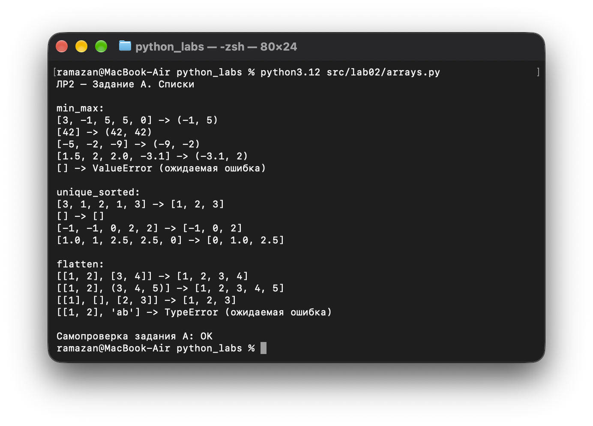
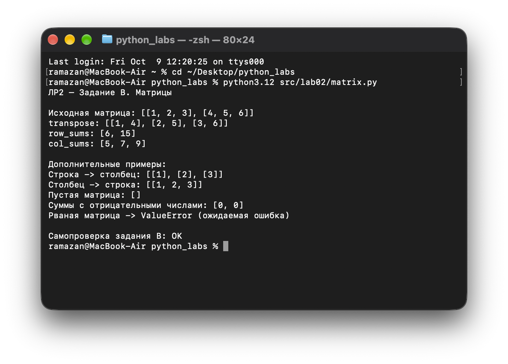
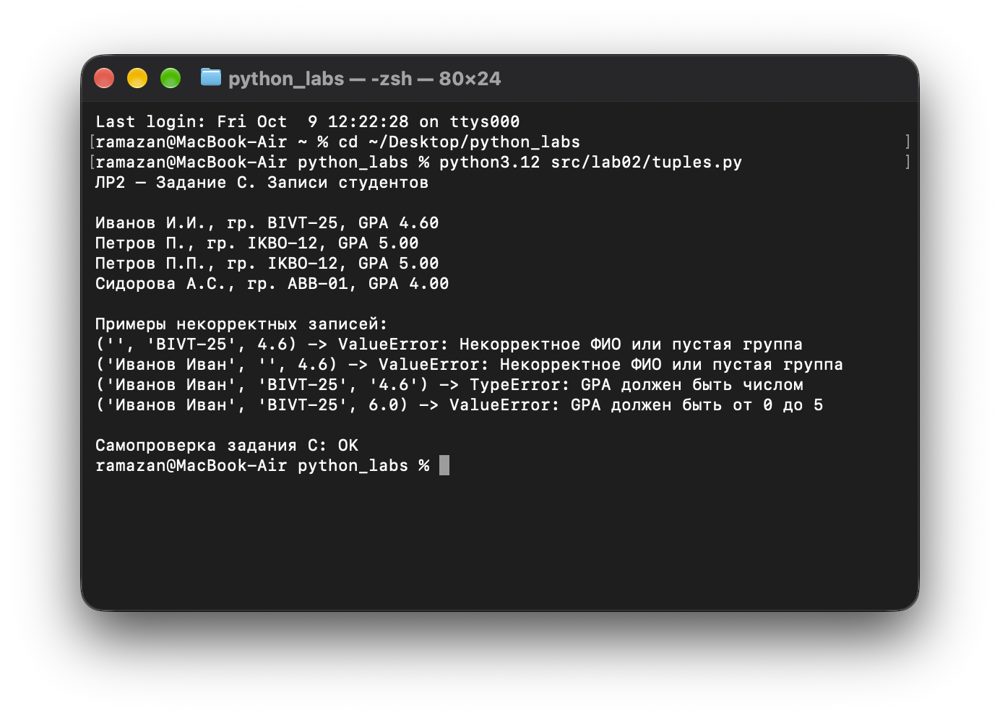

# Лабораторная работа 2. Коллекции и матрицы

### Задание A. Списки: минимум, сортировка, объединение
* **Скрипт:** `arrays.py`
* **Описание:** функция `min_max()` находит минимум и максимум без `min()` и `max()`; `unique_sorted()` оставляет уникальные значения и сортирует их по возрастанию без `sort()` и `sorted()`; `flatten()` объединяет списки и кортежи в один список по строкам. Для пустого списка `min_max()` вызывает `ValueError`, для неправильной строки `flatten()` — `TypeError`.

**Пример работы функций:**
```python
from src.lab02.arrays import min_max, unique_sorted, flatten

print(min_max([3, -1, 5, 5, 0]))           # (-1, 5)
print(unique_sorted([3, 1, 2, 1, 3]))     # [1, 2, 3]
print(flatten([[1, 2], (3, 4, 5)]))        # [1, 2, 3, 4, 5]
```

**Запуск из корня репозитория:**
```bash
python3 src/lab02/arrays.py
```

#### Результат работы:


---

### Задание B. Матрицы: транспонирование и суммы
* **Скрипт:** `matrix.py`
* **Описание:** `transpose()` меняет местами строки и столбцы, `row_sums()` считает суммы по строкам, а `col_sums()` — по столбцам. Для матриц с разной длиной строк предусмотрена ошибка `ValueError`. Пустая матрица `[]` обрабатывается без ошибки.

**Пример работы функций:**
```python
from src.lab02.matrix import transpose, row_sums, col_sums

mat = [[1, 2, 3], [4, 5, 6]]
print(transpose(mat))  # [[1, 4], [2, 5], [3, 6]]
print(row_sums(mat))   # [6, 15]
print(col_sums(mat))   # [5, 7, 9]
```

**Запуск из корня репозитория:**
```bash
python3 src/lab02/matrix.py
```

#### Результат работы:


---

### Задание C. Кортежи: запись студента
* **Скрипт:** `tuples.py`
* **Описание:** `format_record()` получает кортеж `(ФИО, группа, GPA)` и возвращает фамилию с инициалами, номер группы и GPA с двумя знаками после точки. Лишние пробелы удаляются, GPA должен быть в диапазоне от 0 до 5.

**Пример работы функции:**
```python
from src.lab02.tuples import format_record

student = ("Иванов Иван Иванович", "BIVT-25", 4.6)
print(format_record(student))
# 'Иванов И.И., гр. BIVT-25, GPA 4.60'
```

**Запуск из корня репозитория:**
```bash
python3 src/lab02/tuples.py
```

#### Результат работы:


---

### Проверка выполнения
При запуске каждого скрипта в терминал выводятся результаты примеров из задания, случаи некорректного ввода и надпись **«Самопроверка задания …: OK»**. Для этого в конце каждого скрипта используются встроенные проверки `assert`; отдельные библиотеки и файлы с тестами не требуются.

Скриншоты работы программ необходимо сделать **в терминале своего MacBook** и сохранить как:
* `images/lab02/img01.png` — `arrays.py`;
* `images/lab02/img02.png` — `matrix.py`;
* `images/lab02/img03.png` — `tuples.py`.

Пример сохранения снимка прямо в папку репозитория:
```bash
screencapture -i images/lab02/img01.png
```

После добавления скриншотов они автоматически появятся в README по ссылкам выше.
