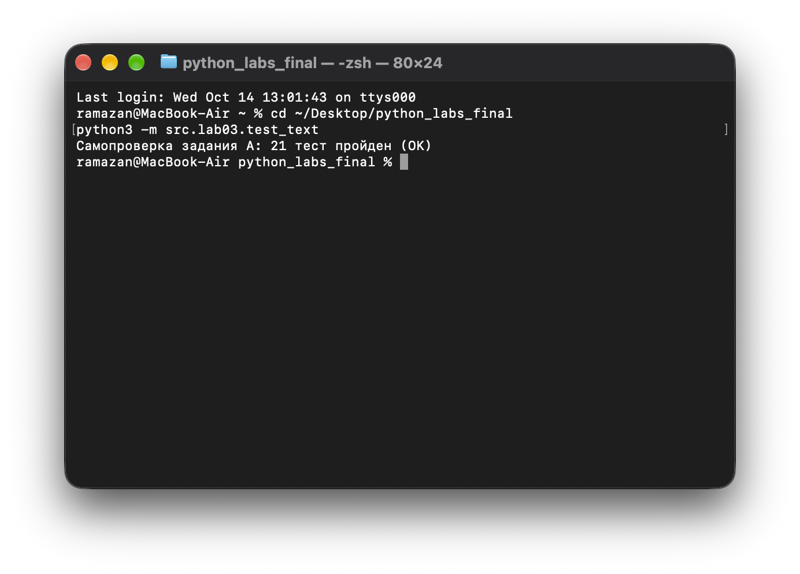
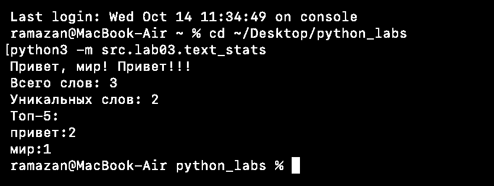

# Лабораторная работа 3. Тексты и частоты слов

**Цель:** нормализовать текст, выделить слова, подсчитать частоты и вывести топ-5. Python 3.10+, только стандартная библиотека.

### Задание A. Обработка текста
* **Скрипт:** `src/lib/text.py`
* **Описание:** `normalize()` приводит текст к единому виду; `tokenize()` выделяет слова (включая слова с дефисом); `count_freq()` считает повторения; `top_n()` сортирует по убыванию частоты, а при равенстве — по алфавиту.

**Код:**
```python
import re


def normalize(text: str, *, casefold: bool = True,
              yo2e: bool = True) -> str:
    """Привести текст к единому виду."""
    if casefold:
        text = text.casefold()
    else:
        text = text.lower()

    if yo2e:
        text = text.replace("ё", "е")
        text = text.replace("Ё", "Е")

    text = " ".join(text.split())
    return text


def tokenize(text: str) -> list[str]:
    """Разбить текст на слова с сохранением дефисов внутри слов."""
    return re.findall(r"\w+(?:-\w+)*", text)


def count_freq(tokens: list[str]) -> dict[str, int]:
    """Подсчитать количество вхождений каждого слова."""
    freq = {}
    for word in tokens:
        freq[word] = freq.get(word, 0) + 1
    return freq


def top_n(freq: dict[str, int], n: int = 5) -> list[tuple[str, int]]:
    """Получить n самых частых слов с алфавитным разрешением равенств."""
    pairs = sorted(freq.items(), key=lambda item: (-item[1], item[0]))
    return pairs[:n]
```

**Проверка:**
```bash
python3 -m src.lab03.test_text
```
Тесты проверяют регистр, букву «ё», пробелы, дефисы, числа, эмодзи и равные частоты. Ожидаемый результат: `Самопроверка задания A: 21 тест пройден (OK)`.

#### Результат работы


---

### Задание B. Статистика слов
* **Скрипт:** `src/lab03/text_stats.py`
* **Описание:** программа читает одну строку из `stdin`, выводит общее число слов, число уникальных слов и пять наиболее частых слов.

**Код:**
```python
from src.lib.text import normalize, tokenize, count_freq, top_n


def main():
    """Прочитать строку и вывести статистику слов."""
    text = input()

    clean_text = normalize(text)
    words = tokenize(clean_text)
    freq = count_freq(words)
    top = top_n(freq, 5)

    print("Всего слов:", len(words))
    print("Уникальных слов:", len(freq))
    print("Топ-5:")

    for word, count in top:
        print(f"{word}:{count}")


if __name__ == "__main__":
    main()
```

**Запуск из корня репозитория:**
```bash
python3 -m src.lab03.text_stats
```

**Пример ввода:** `Привет, мир! Привет!!!`

**Результат:**
```text
Всего слов: 3
Уникальных слов: 2
Топ-5:
привет:2
мир:1
```

#### Результат работы

