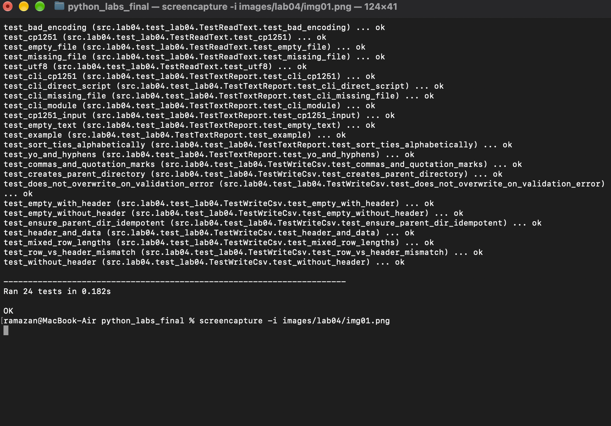
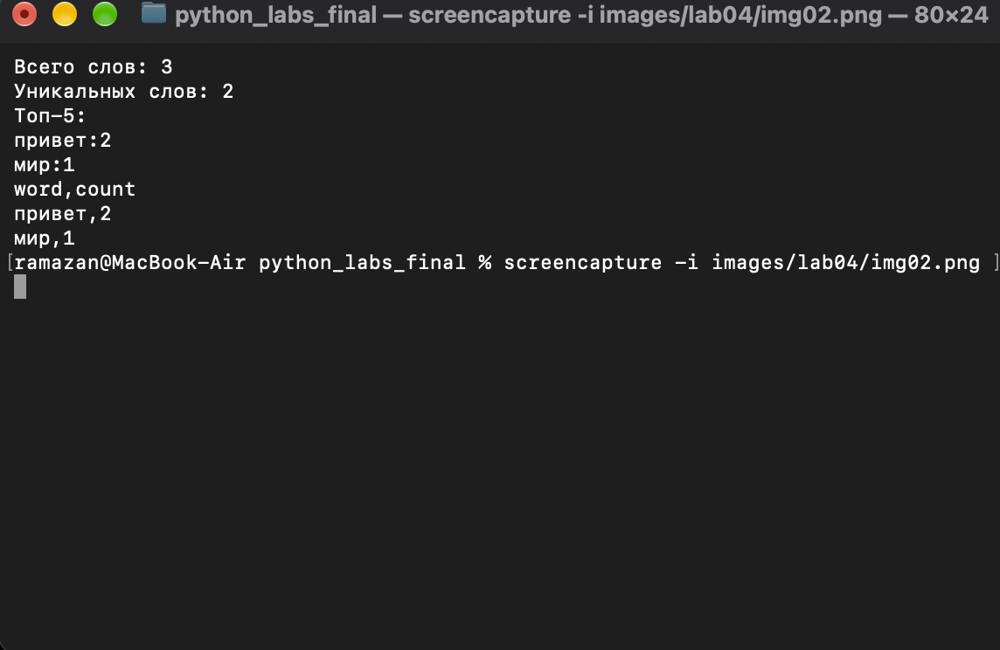

# Лабораторная работа 4. Файлы TXT/CSV и отчёт по словам

**Цель:** научиться читать текстовые файлы, сохранять CSV и повторно использовать функции ЛР3. Python 3.10+, только стандартная библиотека.

### Задание A. Чтение TXT и запись CSV

* **Скрипт:** `src/lab04/io_txt_csv.py`.
* **Описание:** `read_text()` читает файл целиком с выбранной кодировкой; `write_csv()` создаёт CSV с разделителем `,` и необязательным заголовком; `ensure_parent_dir()` создаёт недостающие родительские папки.
* **Проверки:** разные длины строк CSV вызывают `ValueError` **до записи файла**; отсутствующий TXT вызывает `FileNotFoundError`; неподходящая кодировка может вызвать `UnicodeDecodeError`.

**Примеры использования из корня репозитория:**

```bash
python3 -c 'from src.lab04.io_txt_csv import read_text; print(read_text("data/input.txt"))'
python3 -c 'from src.lab04.io_txt_csv import write_csv; write_csv([("кот", 2)], "data/lab04/check.csv", header=("word", "count"))'
```

**Кодировки:** по умолчанию `UTF-8`; для текста в Windows-1251 передайте `encoding="cp1251"` в `read_text()`. Пустой TXT возвращает `""`. Для очень больших файлов в реальных проектах лучше читать данные построчно, хотя по условию этой ЛР файл читается целиком.

**Граничные случаи для CSV:** `rows=[]` без заголовка создаёт пустой файл; при `header=("word", "count")` создаётся файл только с заголовком. Длина каждой строки должна совпадать с длиной заголовка (если он указан).

### Задание B. Статистика текста и CSV-отчёт

* **Скрипт:** `src/lab04/text_report.py`.
* **Описание:** читает TXT, использует `normalize()`, `tokenize()`, `count_freq()`, `top_n()` из ЛР3 и записывает все пары `слово,частота` в `data/report.csv`.
* **Порядок сортировки:** сначала количество по убыванию, при равенстве — слово по алфавиту.

**Запуск из корня репозитория:**

```bash
python3 src/lab04/text_report.py
python3 -m src.lab04.text_report --in data/input.txt --out data/report.csv
```

**Смена кодировки входного файла:**

```bash
python3 -m src.lab04.text_report --in data/input.txt --out data/report.csv --encoding cp1251
```

**Пример входного файла `data/input.txt`:**

```text
Привет, мир! Привет!!!
```

**Ожидаемый вывод в консоли:**

```text
Всего слов: 3
Уникальных слов: 2
Топ-5:
привет:2
мир:1
```

**Содержимое `data/report.csv`:**

```csv
word,count
привет,2
мир,1
```

**Ошибки и пустой ввод:** если файл не найден или его нельзя прочитать, программа печатает понятную ошибку в `stderr` и завершается с кодом `1`. Если TXT пустой, CSV содержит **только заголовок** `word,count`, а в консоли показаны нулевые количества.

### Самопроверка

**Файл:** `src/lab04/test_lab04.py`.

```bash
python3 -m unittest src.lab04.test_lab04 -v
```

**Результат:** 24 теста (`Ran 24 tests ... OK`). Проверяются UTF-8 и CP1251, пустой/отсутствующий файл, ошибки декодирования, заголовок CSV, пустые строки, несовпадение числа столбцов, создание папок, кавычки и запятые, сортировка при равных частотах, дефисы, а также запуск скрипта с аргументами и без `-m`.

### Скриншоты запуска

**Задание A — 24 теста:**



**Задание B — запуск программы и CSV:**


