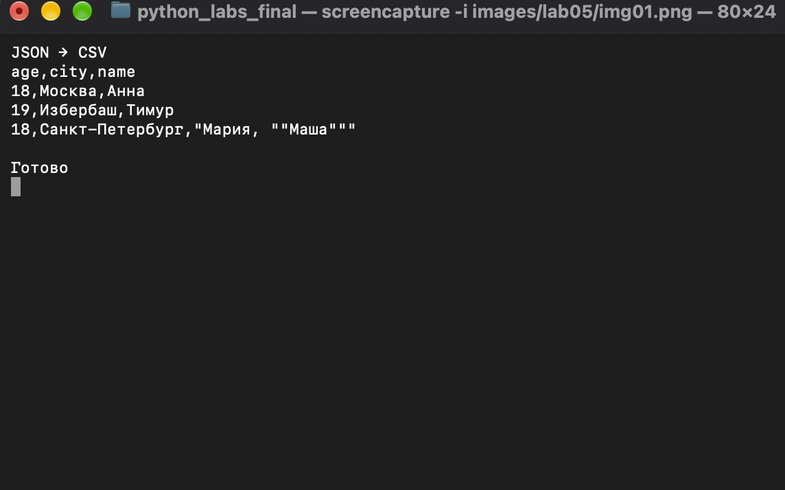
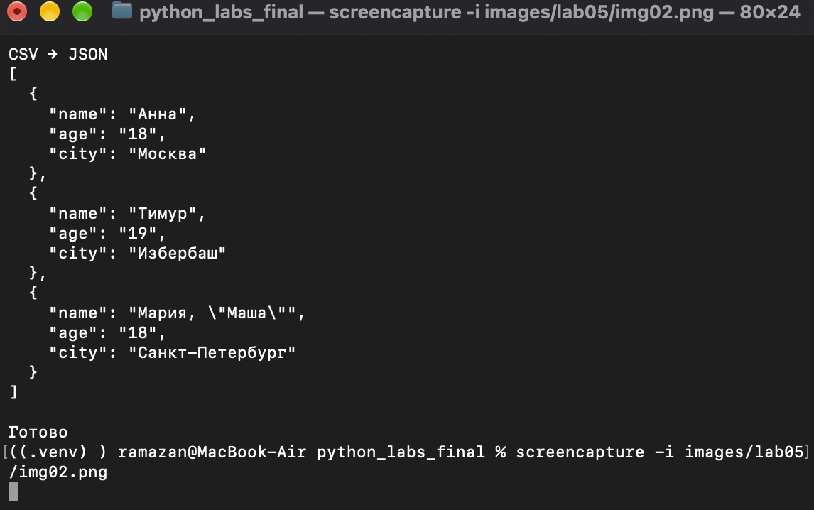
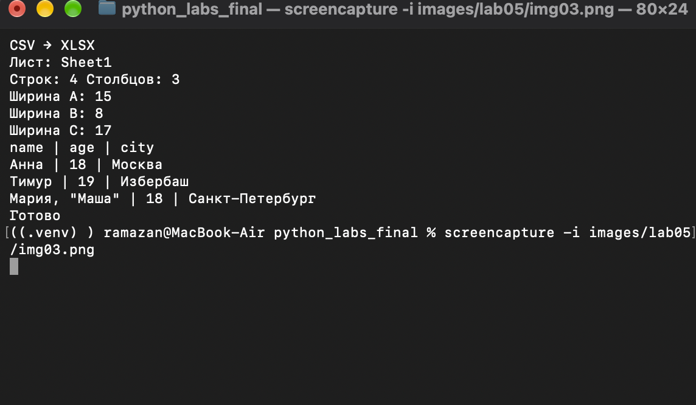

# Лабораторная работа №5. JSON и конвертации

**Цель:** изучить JSON, сериализацию и десериализацию, преобразование JSON ↔ CSV и CSV → XLSX.

**Условие:** [ТЗ лабораторной №5](https://github.com/outtathe/python_bivt/blob/main/src/lab05/README.md).

| Формат | Описание |
| :--- | :--- |
| JSON | Текстовый формат объектов и списков; сохраняет типы данных. |
| CSV | Текстовая таблица с заголовком; значения читаются как строки. |
| XLSX | Книга Excel с листами, строками и столбцами. |

**Файлы работы:** [json_csv.py](json_csv.py), [csv_xlsx.py](csv_xlsx.py), [demo.py](demo.py), [test_lab05.py](test_lab05.py). Исходные примеры — в [`data/samples`](../../data/samples), результаты — в [`data/out`](../../data/out).

## Подготовка

Команды выполняются **из корня репозитория**. Для XLSX нужна единственная внешняя библиотека `openpyxl` из [`requirements.txt`](../../requirements.txt):

```bash
python3.12 -m pip install -r requirements.txt
```

## Задание A. JSON ↔ CSV

### A.1. JSON → CSV

**Функция:** `json_to_csv(json_path, csv_path)` из [json_csv.py](json_csv.py).

Программа читает JSON как список словарей через `json.load()`, объединяет ключи в алфавитном порядке и записывает таблицу с помощью `csv.DictWriter`. Если поля нет у какого-либо объекта, в CSV записывается пустая строка.

**Вход:** [`data/samples/people.json`](../../data/samples/people.json) — 3 объекта с полями `name`, `age`, `city`.

**Запуск:**

```bash
python3.12 -m src.lab05.demo json-to-csv
```

**Результат:** [`data/out/people_from_json.csv`](../../data/out/people_from_json.csv)

```csv
age,city,name
18,Москва,Анна
19,Избербаш,Тимур
18,Санкт-Петербург,"Мария, ""Маша"""
```

Заголовок содержит 3 столбца, количество записей сохранилось: **3 → 3**.



---

### A.2. CSV → JSON

**Функция:** `csv_to_json(csv_path, json_path)` из [json_csv.py](json_csv.py).

`csv.DictReader` использует первую строку CSV как заголовок и преобразует записи в словари. `json.dump(..., ensure_ascii=False, indent=2)` сохраняет результат с читаемой кириллицей и отступами. Все значения из CSV остаются **строками**.

**Вход:** [`data/samples/people.csv`](../../data/samples/people.csv).

**Запуск:**

```bash
python3.12 -m src.lab05.demo csv-to-json
```

**Результат:** [`data/out/people_from_csv.json`](../../data/out/people_from_csv.json), 3 объекта. Пример первого:

```json
{
  "name": "Анна",
  "age": "18",
  "city": "Москва"
}
```

Количество записей сохранилось: **3 → 3**. При преобразовании CSV → JSON числа остаются строками: например, `"18"`, а не `18`.



---

## Задание B. CSV → XLSX

**Функция:** `csv_to_xlsx(csv_path, xlsx_path)` из [csv_xlsx.py](csv_xlsx.py).

CSV читается в UTF-8. Через `openpyxl.Workbook()` создаётся Excel-файл; `sheet.append()` добавляет строки. Первая строка — заголовок, единственный лист называется `Sheet1`. Ширина каждого столбца зависит от длины текста, но не меньше **8**.

**Вход:** [`data/samples/people.csv`](../../data/samples/people.csv). Дополнительный пример — [`cities.csv`](../../data/samples/cities.csv).

**Запуск и проверка XLSX:**

```bash
python3.12 -m src.lab05.demo csv-to-xlsx
```

**Результат:** [`data/out/people.xlsx`](../../data/out/people.xlsx)

| Параметр | Результат |
| :--- | :--- |
| Лист | `Sheet1` |
| Строк с заголовком | 4 |
| Столбцов | 3 |
| Ширина столбцов A / B / C | 15 / 8 / 17 |

Файл открывается с помощью `openpyxl.load_workbook()`; данные и заголовки находятся в соответствующих ячейках. Содержимое можно проверить в Excel или другой программе для электронных таблиц.



---

## Проверка и особенности

```bash
python3.12 -m unittest src.lab05.test_lab05 -v
```

**Результат:** 10 тестов — `OK`. Проверены три конвертации, пустые и неверные данные, отсутствие файлов, кодировка UTF-8, сохранение строковых значений, структура XLSX и ширина столбцов.

| Ситуация | Результат |
| :--- | :--- |
| Отсутствует входной файл | `FileNotFoundError` |
| Неверное расширение, пустой или некорректный JSON/CSV | `ValueError` |
| CSV без корректного заголовка или с разным числом полей | `ValueError` |
| CSV только с заголовком | Допустим: пустой список JSON или XLSX с заголовком |

**Допущения:** JSON должен содержать непустой список словарей с простыми значениями (строки, числа, `true`/`false`). `null` и вложенные объекты не преобразуются в CSV. Для CSV используется разделитель `,`, кодировка UTF-8 и `newline=""`. Программа запускается из корня репозитория через `python -m`, поэтому относительные пути находятся правильно.

## Вывод

Выполнены три преобразования: JSON → CSV, CSV → JSON и CSV → XLSX. Все результаты сохранены в `data/out`; данные и количество записей проверены, XLSX имеет лист `Sheet1` и автоматическую ширину столбцов.
