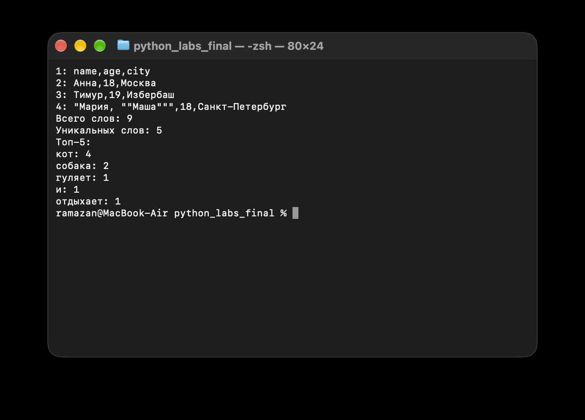
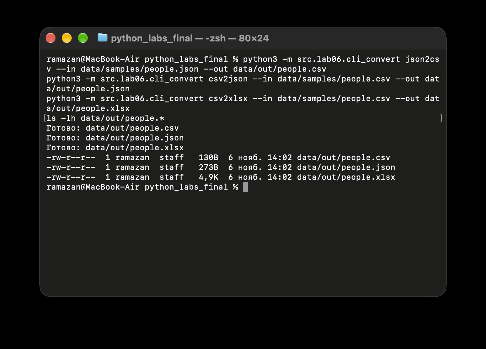
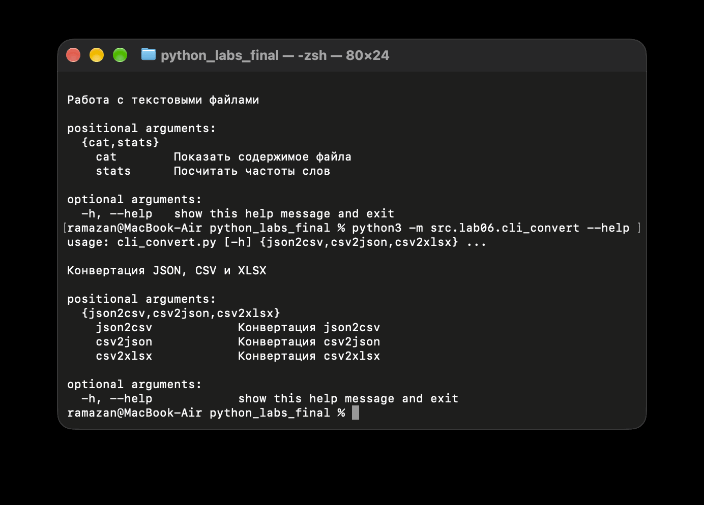

# Лабораторная работа №6. CLI-утилиты с argparse

**Цель:** научиться создавать консольные программы с подкомандами, параметрами и справкой `--help`.

**Задание:** [ТЗ преподавателя](https://github.com/outtathe/python_bivt/blob/main/src/lab06/README.md).

В работе используются стандартный модуль `argparse`, функции обработки текста из ЛР3 и функции конвертации из ЛР5. Новых зависимостей нет. Для CSV → XLSX используется `openpyxl`, уже установленный по [`requirements.txt`](../../requirements.txt) в ЛР5.

**Файлы:** [`cli_text.py`](cli_text.py), [`cli_convert.py`](cli_convert.py). Входные данные — [`data/samples`](../../data/samples), результаты — [`data/out`](../../data/out).

## Подготовка

Команды выполняются **из корня репозитория**. Установить зависимость из ЛР5 (если ещё не установлена):

```bash
python3 -m pip install -r requirements.txt
```

## Задание A. Работа с текстом (`cli_text.py`)

| Подкоманда | Параметры | Назначение |
| :--- | :--- | :--- |
| `cat` | `--input` — обязательный путь; `-n` — необязательная нумерация | Вывод содержимого файла построчно |
| `stats` | `--input` — обязательный путь; `--top` — число слов, по умолчанию 5 | Частоты слов с использованием функций ЛР3 |

**Вывод файла с нумерацией:**

```bash
python3 -m src.lab06.cli_text cat --input data/samples/people.csv -n
```

```text
1: name,age,city
2: Анна,18,Москва
3: Тимур,19,Избербаш
4: "Мария, ""Маша""",18,Санкт-Петербург
```

**Статистика текста:**

```bash
python3 -m src.lab06.cli_text stats --input data/samples/people.txt --top 5
```

```text
Всего слов: 9
Уникальных слов: 5
Топ-5:
кот: 4
собака: 2
гуляет: 1
и: 1
отдыхает: 1
```

Используются `normalize()`, `tokenize()`, `count_freq()`, `top_n()` из [`src/lib/text.py`](../lib/text.py). При одинаковой частоте слова сортируются по алфавиту.



## Задание B. Конвертация (`cli_convert.py`)

| Подкоманда | Обязательные параметры | Функция из ЛР5 |
| :--- | :--- | :--- |
| `json2csv` | `--in`, `--out` | `json_to_csv()` |
| `csv2json` | `--in`, `--out` | `csv_to_json()` |
| `csv2xlsx` | `--in`, `--out` | `csv_to_xlsx()` |

**JSON → CSV:**

```bash
python3 -m src.lab06.cli_convert json2csv --in data/samples/people.json --out data/out/people.csv
```

Результат — [`data/out/people.csv`](../../data/out/people.csv):

```csv
age,city,name
18,Москва,Анна
19,Избербаш,Тимур
18,Санкт-Петербург,"Мария, ""Маша"""
```

**CSV → JSON:**

```bash
python3 -m src.lab06.cli_convert csv2json --in data/samples/people.csv --out data/out/people.json
```

Результат — [`data/out/people.json`](../../data/out/people.json): список из 3 словарей. Значения CSV сохраняются строками, например `"age": "18"`.

**CSV → XLSX:**

```bash
python3 -m src.lab06.cli_convert csv2xlsx --in data/samples/people.csv --out data/out/people.xlsx
```

Результат — [`data/out/people.xlsx`](../../data/out/people.xlsx): лист `Sheet1`, 4 строки с заголовком и 3 столбца. Формат XLSX проверен открытием через `openpyxl`.

После каждой успешной конвертации программа выводит `Готово: <путь к файлу>`.



## Справка и проверка ошибок

**Справка по утилитам:**

```bash
python3 -m src.lab06.cli_text --help
python3 -m src.lab06.cli_convert --help
```

**Справка по каждой подкоманде:**

```bash
python3 -m src.lab06.cli_text cat --help
python3 -m src.lab06.cli_text stats --help
python3 -m src.lab06.cli_convert json2csv --help
python3 -m src.lab06.cli_convert csv2json --help
python3 -m src.lab06.cli_convert csv2xlsx --help
```



**Обработка ошибок:**

| Случай | Поведение |
| :--- | :--- |
| Входной файл не найден | При чтении возникает `FileNotFoundError`; CLI показывает понятную ошибку |
| Неизвестная команда или отсутствует обязательный параметр | Сообщение `argparse` с подсказкой `usage:` |
| `--top 0` или отрицательное значение | `parser.error()`: требуется положительное число |
| `--top abc` | Ошибка `argparse`: нужно целое число |
| Неверный формат или некорректный JSON/CSV | Сообщение о причине ошибки от функций ЛР5 |
| `--help` | Выводит справку без выполнения команды |

Примеры проверки:

```bash
python3 -m src.lab06.cli_text cat --input data/samples/missing.txt
python3 -m src.lab06.cli_text stats --input data/samples/people.txt --top 0
python3 -m src.lab06.cli_convert json2csv --in data/samples/missing.json --out data/out/people.csv
```

## Вывод

Созданы две CLI-утилиты с пятью подкомандами, обязательными параметрами, дополнительными флагами, справкой и обработкой ошибок. Для обработки текста повторно использован код ЛР3, для конвертации — код ЛР5. Демонстрационные файлы сохранены в `data/out/`.
