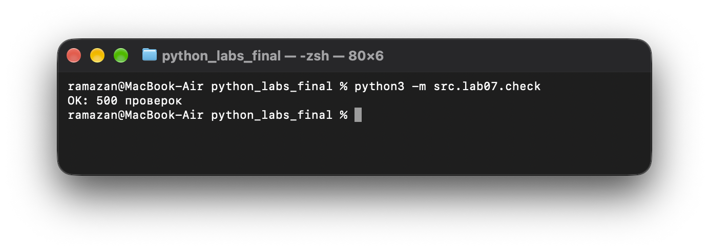
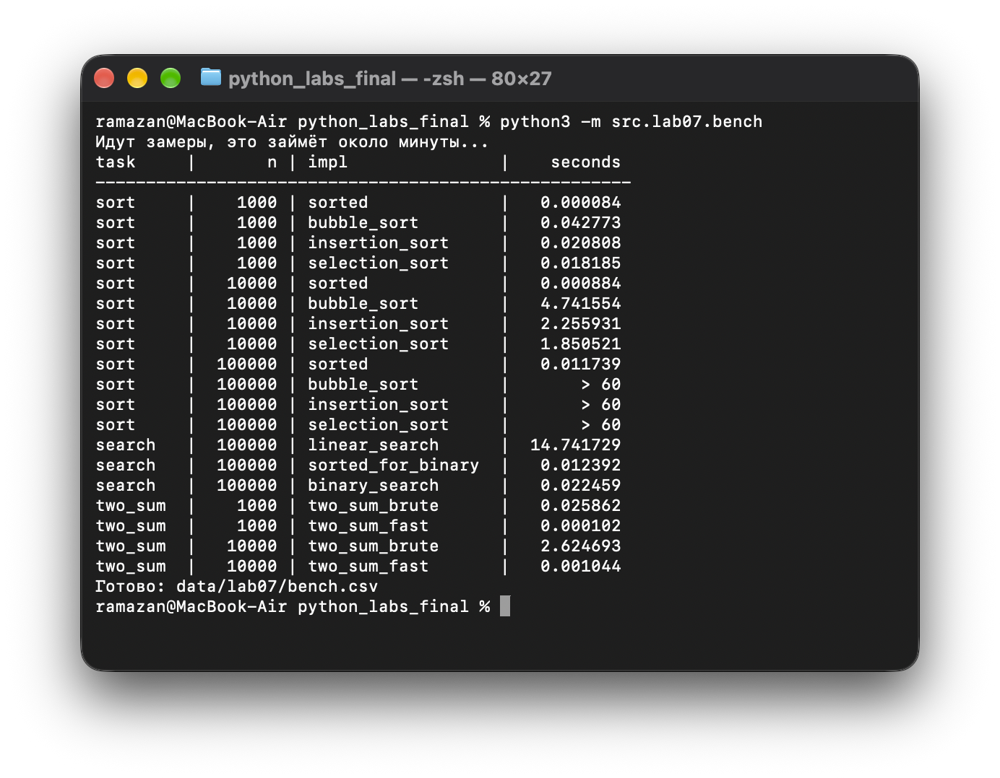
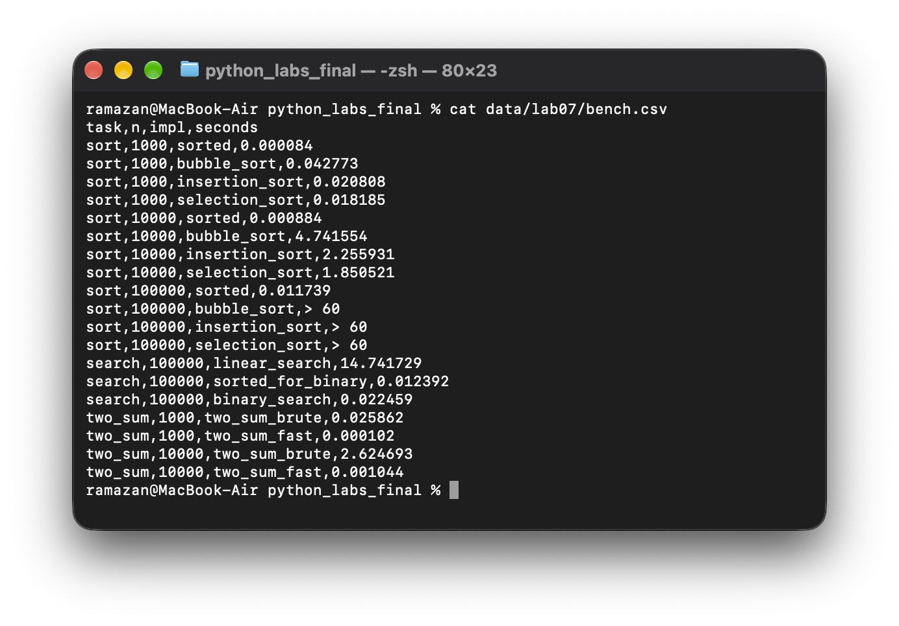

# Лабораторная работа №7. Поиск, сортировка и измерение времени

**Цель:** реализовать базовые алгоритмы поиска и сортировки, проверить их против эталона на случайных данных и измерить время на разных объёмах данных.

**Задание:** [ТЗ преподавателя](https://github.com/outtathe/python_bivt/blob/main/src/lab07/README.md).

Используются только стандартные модули `random` и `timeit`. Таблица замеров записывается в CSV функцией `write_csv()` из [ЛР4](../lab04/io_txt_csv.py). Новых зависимостей нет.

**Файлы:** [`search.py`](search.py), [`sorting.py`](sorting.py), [`check.py`](check.py), [`bench.py`](bench.py). Результат замеров — [`data/lab07/bench.csv`](../../data/lab07/bench.csv).

## Подготовка

Команды выполняются **из корня репозитория**. Порядок работы: сначала `check.py` (ответ совпадает со встроенным?), потом `bench.py` (замеры). Если проверка не прошла — мерить нечего.

## Задание A. Поиск (`search.py`)

| Функция | Что возвращает | Сложность |
| :--- | :--- | :--- |
| `linear_search(nums, x)` | индекс первого вхождения или `-1` | O(n) |
| `binary_search(sorted_nums, x)` | индекс любого вхождения или `-1`; список **уже отсортирован** | O(log n) |
| `two_sum_brute(nums, target)` | пара `(i, j)`, `i < j`, или `None` — перебор всех пар | O(n²) |
| `two_sum_fast(nums, target)` | то же через словарь «значение → индекс» за один проход | O(n) |

`binary_search` использует цикл `while lo <= hi`: смотрит в середину и отбрасывает половину списка. На неотсортированном списке результат не определён — это указано в docstring. В `two_sum_fast` для каждого числа проверяется, встречалось ли уже `target − x`; `in` у словаря — O(1), поэтому вложенного цикла нет.

```python
linear_search([4, 2, 7, 2], 2)     # 1
binary_search([1, 3, 5, 7], 4)     # -1
two_sum_brute([2, 7, 11, 15], 9)   # (0, 1)
two_sum_fast([1, 2], 10)           # None
```

## Задание B. Сортировки (`sorting.py`)

| Функция | Идея | Сложность |
| :--- | :--- | :--- |
| `bubble_sort(nums)` | меняем соседей, если стоят не по порядку; максимум «всплывает» в конец | O(n²) |
| `insertion_sort(nums)` | очередной элемент сдвигаем влево, пока он не встанет на место | O(n²) |
| `selection_sort(nums)` | находим минимум оставшейся части и ставим на место | O(n²) |

Каждая функция начинается с `nums = list(nums)`, поэтому **возвращает новый список**, а исходный не меняется. Готовые `sorted`, `.sort()`, `min`, `max` внутри не используются. Пустой список и список из одного элемента обрабатываются без особых случаев. В пузырьке есть флаг `swapped` (★): если за проход не было обменов, сортировка завершается досрочно.

```python
bubble_sort([3, 1, 2])     # [1, 2, 3]
bubble_sort([2, 2, 1])     # [1, 2, 2]
bubble_sort([])            # []
```

## Задание C. Проверка против эталона (`check.py`)

| Функция | Что проверяет |
| :--- | :--- |
| `check_sorting(fn, trials=100)` | `fn(nums) == sorted(nums)` и исходный список не изменён |
| `check_search()` | `linear_search` против `list.index` (`-1` против `ValueError`); `binary_search` на отсортированных списках: `x`, которого нет, и крайние элементы |
| `check_two_sum(trials=100)` | оба способа дают пару `i < j` с нужной суммой или оба `None` |

Случайные списки длиной от 0 до 50 со значениями от −100 до 100, с повторами и отрицательными числами, `random.seed(42)`. При расхождении — `AssertionError` с самим списком в сообщении.

```bash
python3 -m src.lab07.check
```

```text
OK: 500 проверок
```



**Результат:** 500 прогонов (по 100 на каждую из трёх сортировок, поиск и Two Sum), расхождений не найдено. Чтобы убедиться, что проверка действительно ловит ошибки, в пузырьке намеренно уменьшалась граница внутреннего цикла на 1 — `check_sorting` сразу упал с `AssertionError: bubble_sort ошиблась на [-72, -94, 89, ...]`. После возврата правильной границы проверка снова печатает `OK`.

## Задание D. Бенчмарк (`bench.py`)

```bash
python3 -m src.lab07.bench
```



Замеры устроены по чеклисту лекции 8:

- данные генерируются **до** замера, `random.seed(42)`, все алгоритмы получают **одни и те же** данные;
- `timeit.repeat(..., number=1, repeat=3)`, берётся **минимум** из повторов;
- внутри замера нет `print`;
- квадратичные сортировки на `n = 100 000` не запускаются: при росте `n` в 10 раз они замедляются примерно в 100 раз, поэтому 4,7 с на `n = 10 000` превратились бы в ~8 минут — в таблице `> 60`;
- для бинарного поиска время сортировки записано **отдельной строкой** `sorted_for_binary`;
- в Two Sum все числа меньше 10⁶, кроме двух последних, поэтому ответ гарантированно есть и это единственная пара `(n − 2, n − 1)` — худший случай для перебора.

Полная таблица — [`data/lab07/bench.csv`](../../data/lab07/bench.csv), колонки `task,n,impl,seconds`.



**Сортировки**, время в секундах:

| impl | n = 1 000 | n = 10 000 | n = 100 000 | рост при n ×10 |
| :--- | ---: | ---: | ---: | :---: |
| `bubble_sort` | 0.042773 | 4.741554 | > 60 | ×111 |
| `insertion_sort` | 0.020808 | 2.255931 | > 60 | ×108 |
| `selection_sort` | 0.018185 | 1.850521 | > 60 | ×102 |
| `sorted` | 0.000084 | 0.000884 | 0.011739 | ×11, ×13 |

**Поиск**: 10 000 запросов к списку из 100 000:

| impl | секунды |
| :--- | ---: |
| `linear_search` | 14.741729 |
| `sorted_for_binary` (сортировка один раз) | 0.012392 |
| `binary_search` | 0.022459 |
| **бинарный вместе с сортировкой** | **0.034851** |

**Two Sum**:

| impl | n = 1 000 | n = 10 000 | рост при n ×10 |
| :--- | ---: | ---: | :---: |
| `two_sum_brute` | 0.025862 | 2.624693 | ×101 |
| `two_sum_fast` | 0.000102 | 0.001044 | ×10 |

## Выводы

Пузырёк при росте `n` в 10 раз замедлился примерно в 100 раз (×111), потому что у него два вложенных цикла по `n` — это O(n²), и (10n)² = 100·n² шагов. Вставки и выбор тоже квадратичные и дали ×108 и ×102. `sorted` (Timsort) работает за O(n log n): при росте `n` в 10 раз число шагов растёт в 10 · log(10n)/log(n) ≈ 12 раз, что и видно в замере (×13 при переходе 10⁴ → 10⁵). К тому же `sorted` написан на C, поэтому быстрее даже на маленьком `n` — это константа, но главное различие — порядок: на `n = 10 000` пузырёк медленнее `sorted` в 5 400 раз. То же в Two Sum: перебор пар O(n²) дал ×101, словарь O(n) — ×10.

Бинарный поиск без сортировки бесполезен: он отбрасывает половину списка, только если слева все элементы меньше, а справа больше; на неотсортированном списке ответ не определён. Сортировка стоит O(n log n), а один линейный поиск — O(n), поэтому ради одного запроса сортировать невыгодно. Сортировка окупается, когда запросов много: здесь один линейный поиск занимает ~1,5 мс, а сортировка — ~12 мс, то есть она окупается уже примерно с 8 запросов. На 10 000 запросах бинарный поиск вместе с сортировкой (0,035 с) оказался быстрее линейного (15 с) примерно в 420 раз.

`check.py` выполнил 500 прогонов на случайных данных и расхождений не нашёл; намеренно внесённая ошибка в пузырьке была поймана сразу, с конкретным списком в сообщении.
